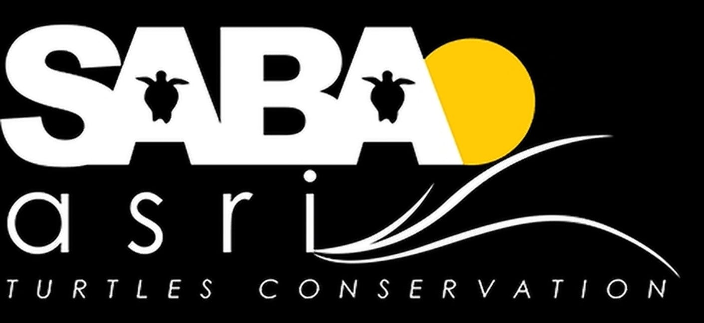

  

# SABA asri Turtle Conservation - Live Interpreter

**Speak in one language and see it translated into another - on your phone or computer.**

## 👉 [Open the Translator](https://tinyurl.com/saba-asri-translator) 👈

**Full Link: [https://tinyurl.com/saba-asri-translator](https://tinyurl.com/saba-asri-translator)**

Nothing to install and no account needed. It works in your web browser - **and, once downloaded, with no internet at all.**

**Languages:** English · French · German · Mandarin Chinese · Japanese · Indonesian, in any direction.

---

## How to use it?

1. **Open the link** above.
2. Choose the language you will speak (**I speak**) and the language you want to read (**Translate to**).
3. **Tap the black microphone button.** The first time, your browser asks to use the microphone. Tap **Allow**.
4. **Speak normally.** Pause briefly after each sentence. Each sentence appears with its translation underneath, newest at the top.
5. **Tap the button again** to stop.

> 💡 **Talking with someone?** Tap ⇄ to swap the languages when it's their turn to speak.

---

## Use it without internet!

For places with a weak or no connection. Do this **once per language pair, on each phone or computer**, somewhere with good internet (office Wi-Fi, home, a café):

1. Open the link and choose the two languages you need.
2. Tap **Download for offline use** (the button shows the size) and keep the page open until it says **✓ … works without internet on this device**.
3. **iPhone/iPad:** add the page to your Home Screen (**Share → Add to Home Screen**) and open it from there from now on. Safari may clear downloads of websites that aren't used for 7 days; Home Screen apps are kept.
4. Repeat for any other language pair you need.

From then on the app opens and works with **no connection at all** - speech recognition and translation run on the device itself.

**With internet, it still helps:** translation uses the online service first, but if that's slower than translating on the device would be, the on-device translator takes over for that sentence. If the connection stays slow, the app keeps translating on the device for a couple of minutes, then tries online again. You don't need to do anything.

| Pair | One-time download (phone) | (computer) |
|---|---|---|
| English ↔ French, German, Mandarin or Indonesian | ≈ 260 MB | ≈ 300 MB |
| Two non-English languages (e.g. French ↔ Indonesian) | ≈ 480 MB | ≈ 520 MB |
| Anything ↔ Japanese | ≈ 790–900 MB | ≈ 820–930 MB |

*Parts shared between pairs (speech recognition, and the larger model used for translating **into** Japanese) are only downloaded once, so a second pair is usually much smaller.*

**What to expect offline:** text appears after each short pause (about 1–3 seconds), rather than word-by-word. The first sentence after opening the app takes a few extra seconds while the models load. Newer phones are faster.

---

## Which phone or computer?

| Device | Best browser |
|---|---|
| Android phone | **Chrome** |
| iPhone or iPad | **Safari** |
| Computer | **Google Chrome** (gives the best translations) |

Other browsers (Firefox, Edge, Samsung Internet…) work too. The first time, they may need to download speech recognition, which takes a minute.

**On a phone:** keep the page open and the screen on while you talk. If the phone locks, just tap the button again.

**Tip:** add it to your home screen so it opens like an app.
- **Android (Chrome):** tap **⋮**, then **Add to Home screen**.
- **iPhone (Safari):** tap **Share**, then **Add to Home Screen**.

---

## Tips for good translations!

- Speak clearly, in **full sentences**, close to the phone.
- **One person at a time**, and as little background noise as possible.
- Pick the right **I speak** language before you start. The app doesn't guess it.
- Automatic translation is a helpful guide, not a professional interpreter. For medical, legal or other important matters, please use a qualified human interpreter.

---

## Privacy...

- **Nothing is saved.** There are no accounts, no recordings and no history. Close the page and it's gone.
- **Downloaded for offline use:** everything happens on your device. Your voice and words don't leave it.
- **Not downloaded:** to turn speech into text, your browser may send your voice to its own speech service, as it does for voice typing (for example, Google for Chrome and Apple for Safari), and the text may be sent to a free translation service (MyMemory).

---

## Something not working?

| Problem | What to do |
|---|---|
| **"Microphone access was blocked"** | Tap the 🔒 or ⓘ icon next to the web address, set **Microphone** to **Allow**, then reload the page. On iPhone, also check **Settings → Apps → Safari → Microphone**. |
| **Nothing appears when I speak** | Check that **I speak** is set to the language you're speaking, that your microphone isn't muted, and pause briefly after each sentence. On iPhone, make sure **Settings → General → Keyboard → Enable Dictation** is on. |
| **"One-time download"** message | This is normal the first time in some browsers. Wait for it to finish; next time it starts straight away. |
| **"You're offline, and … isn't downloaded"** | That language pair hasn't been downloaded on this device. Next time you have good internet, open the app and tap **Download for offline use**. |
| **The download stopped** | The connection dropped. Tap **Continue download** when you're back online - the parts already downloaded are kept. |
| **"The connection is too slow for online translation"** | Download this language pair once (see *Use it without internet*); it then never needs the connection. |
| **"Today's free translation limit has been reached"** | The free translation service has a daily limit. Try again tomorrow, or use Google Chrome on a computer. |
| **A translation looks odd** | Try saying the whole sentence again, a little more slowly. Very short phrases are the hardest to translate. |
| **Chinese shows Traditional characters** | This can happen outside Chrome and Safari. Use Chrome or Safari for Simplified Chinese. |

---

Made for SABA asri Turtles Conservation. For programmers: the code, tests and technical notes are in [`developer/`](developer/README.md). Speech recognition: your browser's built-in service, or OpenAI's Whisper (MIT) on the device. Translation: Chrome's built-in translator, the MyMemory service, or on the device with Opus-MT models by the University of Helsinki Language Technology Research Group (Apache-2.0 / CC BY 4.0, Tiedemann & Thottingal, "OPUS-MT", EAMT 2020) and Meta's M2M100 (MIT), run with Hugging Face transformers.js (Apache-2.0) and ONNX Runtime (MIT). Code licence: [MIT](LICENSE).
