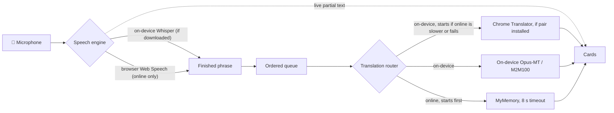

# Developer guide

The technical companion to the main [README](../README.md). Everything a programmer needs to run, test, change, publish and extend Live Interpreter.

**Live site:** https://melvint-comp.github.io/SABA-asri-Live-Interpreter/

**Stack:** plain HTML + CSS + native ES modules. There is no framework, no bundler and no build step, so the files in `app/` are exactly what the browser runs. AI models load at runtime from a CDN through [transformers.js](https://github.com/huggingface/transformers.js), pinned to `4.3.1`.

---

## Run locally

```bash
cd developer
npm start                        # zero-dependency server → http://localhost:8080
# or, from the repo root, with Python:
python3 -m http.server 8080
```

A server is required because browsers block ES modules, workers and `getUserMedia` on `file://`. `localhost` counts as a secure context; a LAN IP over plain `http://` does **not**, so test phones against the deployed HTTPS site or a tunnel.

## Test

```bash
cd developer
npm test           # 68 unit tests, Node ≥ 22.12, no install needed
npm run check      # syntax-check every file in app/js
npm install        # once: puppeteer + Chrome for the browser tests
npm run test:e2e   # 6 headless-Chrome tests
```

**Unit tests (`tests/unit/`)** cover:
- Audio: resampler accuracy at 48 kHz and 44.1 kHz across chunk boundaries; segmenter splitting, pause tolerance, blip rejection, noise immunity, force-cut and flush.
- Built-in speech engine, against a fake `SpeechRecognition` that mimics phones: one phrase per session, sessions ending without a final result, language-code fallback, fatal errors and restart-loop detection.
- Translation: MyMemory byte-limit chunking (including CJK), entity decoding and error/quota handling; router fallback and per-pair memory.
- App logic: settings validation and per-device defaults; device detection; controller ordering, auto-fallback and plain-language errors.
- Translation race (`offline.test.mjs`): quick online answers win without starting on-device; slow online loses to on-device; online failure starts on-device immediately; two losses switch to on-device-first for the cool-down, then online is retried; online-only / offline-only cases; combined error when both fail.
- Offline (`offline.test.mjs`): an on-device plan for all 30 directions; Japanese via M2M100; Simplified-Chinese prefix; **only reviewed, commercially licensed models** (fails if NLLB or `opus-mt-en-jap` appear); pack contents and sizes; never touching the network while offline, the 1.5 s availability limit and its 30 s memory; MyMemory timeout; download manager (only missing parts, monotonic progress, resume after interruption, cache-check fallback); speech engine choice; the service worker lists every app file and its `VERSION` matches both `?v=` tags in `index.html`.

**E2E tests (`tests/e2e/`)** run in real headless Chrome:
1. **Desktop.** A synthetic two-phrase "speech" WAV goes through Chrome's fake microphone. The test checks the whole path: AudioWorklet → resampler → segmenter → worker → translation → cards.
2. **Phone.** Uses an Android user agent at a 360 px viewport. It checks there is no sideways scrolling, the large button, that the page shows only the two language pickers (no technical settings), that the Quick model is used, and that recording works.
3. **`file://`.** Opening the file directly shows the friendly explanation with a link to the live site.
4. **Layout.** Even spacing and a reachable button at six screen sizes.
6. **Update safety (`update.test.mjs`).** Serves an old version with GitHub-Pages-like caching (`max-age=600`), "deploys" the new one, presses Reload, and checks the app repairs itself and starts.
5. **Offline (`offline.test.mjs`).** Loads the app, checks the service worker controls it and the page is `crossOriginIsolated`, downloads a pair, then **shuts the web server down** and goes offline: the app must reopen, show the pair as ready, and turn speech into a translated card with zero requests to any online service. A pair that wasn't downloaded must show the offline explanation.

The AI worker and the MyMemory HTTP API are stubbed, so the tests are fast, offline and deterministic. Real model inference (download sizes, speed and translation quality on real phones), Chrome's Translator API and Web Speech need manual testing.

**Manual checklist** (≈20 min):
- **Offline, real models:** on good Wi-Fi, choose English ↔ Indonesian, tap *Download for offline use*, wait for ✓. Turn on airplane mode, close and reopen the app (on iPhone: from the Home Screen), say a few sentences, and note how long each translation takes.
- **Desktop Chrome:** EN→JA with no URL parameters, then again with `?asr=whisper` (on-device recognition).
- **Firefox:** confirm it falls back to on-device recognition plus MyMemory.
- **Android Chrome and iPhone Safari:** say a few sentences, lock the screen mid-way, and confirm you can resume.
- **Permissions:** deny the microphone and check the error text.

CI (`.github/workflows/tests.yml`) runs the unit and e2e tests on every push and PR. Deployment is GitHub Pages "Deploy from a branch" (root), so publishing needs no workflow.

---

## Publishing & updating the site

The site is served by **GitHub Pages → Deploy from a branch → `main` / `(root)`**. `index.html` must stay at the top level of the repository. Any change pushed to `main` goes live within a few minutes.

**Without a terminal**, on github.com:
1. Open the repository and click **Add file → Upload files**.
2. Drag in the changed files or folders. Keep the same folder structure; a file with the same path replaces the old one.
3. Click **Commit changes**.
4. To delete a file, open it on GitHub, click **⋯ → Delete file**, then **Commit changes**.

**Releasing an update.** The service worker keeps one consistent copy of the app on each device, so visitors never mix old and new files. To publish a change: bump `VERSION` in `sw.js` **and** both `?v=` tags in `index.html` to the same new value (`npm test` fails if they differ, or if a new file in `app/` isn't listed in `sw.js`). Devices pick up the new version in the background and use it from the next visit. Downloaded language packs are kept across updates.

Check **Settings → Pages** if the site doesn't update: the source must be *Deploy from a branch*, branch `main`, folder `/ (root)`.

To host your **own copy**, fork the repository (or upload these files to a new public repository) and enable Pages the same way. Your link becomes `https://YOUR-USERNAME.github.io/REPO-NAME/`. Update the live-site URL in `index.html` (file notice, canonical/og tags, footer) and `app/js/main.js` (secure-context message) to match.

---

## Architecture

**Speech recognition is offline-first** (on-device Whisper whenever downloaded). **Translation is online-first with a fast on-device fallback**: online starts first, and on-device takes over as soon as online is slower than on-device would be. A slow or missing connection therefore never blocks a language pair that has been downloaded.



- **`main.js`** builds the page: two language pickers, the button, the result cards and the "Download for offline use" section. Engine choices come from `DEFAULT_SETTINGS` (phone-aware) plus optional URL overrides; nothing technical is shown to the user.
- **`interpreter.js`** is the controller. It owns start/stop, the auto-fallback from Web Speech to Whisper, and the ordered translation queue. It reads the device context (`phone`, `online`, `speechOnDevice`) fresh at every start. It talks to a small *view* interface (`setStatus`, `setLive`, `setRecording`, `addPhrase`, `setTranslation`) instead of the DOM, which is why it's unit-tested without a browser.
- **Speech engine choice** (`recognition/index.js`): Whisper whenever its model is downloaded; otherwise browser Web Speech if available *and online*; otherwise Whisper.
- **Web Speech engine.** Desktop uses `continuous = true`. Phones use one phrase per session with auto-restart, because continuous mode accumulates or duplicates results on Android and iOS. Leftover interim text is promoted to final on `end`, since iOS often ends without a final result.
- **Whisper engine.** mic → AudioWorklet → linear resampler (Firefox can't attach a mic to a 16 kHz `AudioContext`) → energy VAD segmenter → Web Worker. VAD: 30 ms frames, adaptive noise floor × 3, 700 ms pause ends a phrase, 15 s force-cut. A filter drops Whisper's known hallucinations such as subtitle credits.
- **Translation router** (`translation/index.js`). Each engine reports `availability(src, tgt)` → `ready` (on-device, works offline now) / `needs-network` / `unavailable`. All engines are asked in parallel with a 1.5 s limit (some browsers never answer for Chrome's Translator); answers are remembered for 30 s and pre-computed when Record is pressed, so sentences never wait on the check. Policy (`auto`):
  - offline → on-device engines only; nothing usable → `OfflineNotReadyError`, shown as a plain instruction;
  - online, pair not downloaded → online engines only;
  - online and downloaded → **race with a head start** (`raceOnlineFirst`): online starts; on-device starts when online fails, or when online hasn't answered within the expected on-device time (running average of measured on-device translations, 1 s until measured, clamped 0.3–2 s) — i.e. when online is slower than on-device would be; the first translation wins;
  - online losing twice in a row → on-device goes first for 2 minutes, then online is raced again. Tunables live in `RACE`.
  Permanent failures are remembered per engine and pair.
- **On-device translation** (`translation/on-device.js`, `translationPlan()` in `config.js`). Opus-MT (Marian, ~77M params, ~110 MB q8 each) for X↔English, pivoting through English for two non-English languages; M2M100 418M (~635 MB q8) for any language → Japanese, because no good small English→Japanese model exists (the Opus `en-jap` model's target language is unclear; `opus-tatoeba-en-ja` scores BLEU 15). `en→zh` is prefixed with `>>cmn_Hans<<` (Simplified). It never starts a download by itself in auto mode.
- **Language packs** (`offline/packs.js`). One pack = Whisper + every translation model for both directions of a pair. `status()` asks the worker `isCached` (transformers.js `ModelRegistry.is_pipeline_cached`, `local_files_only` — cache only, never the network); if that can't answer within 5 s it falls back to a localStorage record of completed downloads. `download()` fetches only what's missing, one model at a time with the pipeline disposed afterwards (so a 935 MB Japanese pack doesn't sit in a phone's memory), reports byte progress, and calls `navigator.storage.persist()`.
- **Worker** (`workers/ml.worker.js`). Imports the self-hosted transformers.js bundle (`app/vendor/`). q8 weights on the WASM backend. Keeps at most 2 translation pipelines in memory (LRU, disposed when evicted). transformers.js stores model files *and* the ONNX Runtime `.wasm` in Cache Storage (`transformers-cache`) and checks it before the network.
- **Service worker** (`sw.js`), registered by an inline script in `index.html` (so it works even if the app's modules fail to load). Pre-caches every app file under one versioned cache (`cache: 'reload'` so the stored set is consistent), serves them cache-first, and serves `index.html` for every navigation, so the app opens with no network. Updates wait until the app is closed (no `skipWaiting`), so an open page never mixes versions.
- **Self-repair after updates.** Before the service worker controls a page (e.g. the first visit after upgrading from a version without one), a normal reload can combine a new `index.html` with old HTTP-cached modules; the module graph then fails to link and the app doesn't start. `main.js` marks `<html data-started>`; if that hasn't happened 1.5 s after load, the inline script waits for the service worker and reloads once (guarded by sessionStorage) — the page is then served from the consistent precache. Covered by `tests/e2e/update.test.mjs`, which fails without the repair. Cross-origin requests (models, CDN, MyMemory) are left alone — transformers.js caches models itself, so nothing is stored twice. It also adds `Cross-Origin-Opener-Policy: same-origin` + `Cross-Origin-Embedder-Policy: require-corp` to everything it serves: GitHub Pages can't send those headers, and they make the page `crossOriginIsolated`, which lets ONNX Runtime use multi-threaded WebAssembly. Measured in headless Chromium with the real ONNX Runtime on a plain server: isolated only after the service worker takes over, and 1.66× faster on a 2-core machine (more cores → larger gains, up to ORT's default of 4 threads).
- **Phones.** Phones default to the Quick (tiny) Whisper model, keep the screen awake with the Screen Wake Lock API, and create the `AudioContext` before the first `await` so iOS treats it as user-initiated.

### File map

```
index.html                     page markup (+ inline file:// notice)
app/styles.css                 SABA asri theme (deep-sea header, white body), phone-first, CJK-aware fonts via :lang()
app/fonts/                     Plus Jakarta Sans variable font, self-hosted (SIL OFL 1.1 — see OFL.txt)
app/images/                    saba-asri-logo.png/.webp (original artwork, only trimmed), share.png, touch-icon.png, favicon.png, icon-192/512.png
app/vendor/transformers/       transformers.js 4.3.1 bundle (unmodified, Apache-2.0), self-hosted for offline use
sw.js                          service worker: offline app files + cross-origin isolation (multi-threaded AI)
manifest.webmanifest           lets phones install the app to the Home Screen
app/js/
  main.js                      DOM wiring + view implementation (no logic)
  config.js                    ★ languages, models + translationPlan()/offlinePack(), endpoints, VAD tuning
  settings.js                  URL > localStorage (languages only) > defaults, validated
  device.js                    phone detection, screen wake lock
  interpreter.js               controller
  offline/      packs.js (download / check language packs)
  audio/        microphone.js · capture-processor.js (AudioWorklet) · resample.js · segmenter.js
  recognition/  index.js (picker) · webspeech.js · whisper.js
  translation/  index.js (offline-first router) · chrome-builtin.js · on-device.js · mymemory.js
  workers/      ml.worker.js (transformers.js pipelines) · ml-client.js (RPC)
developer/
  serve.mjs · check-syntax.mjs · package.json · tests/{unit,e2e}
```

---

## Brand & design

**The logo is never altered.** `app/images/saba-asri-logo.png` is the client's original artwork with only the empty black margin trimmed — every pixel is identical to the supplied file (the `.webp` is a lossless copy). Because the artwork comes on black, the header is pure `#000000` so the two blend with no visible edge. Don't recolour, redraw or cut the logo out of its background; if a different version is needed (e.g. for white backgrounds), ask the client for official artwork. `share.png`, `touch-icon.png` and `favicon.png` are the same unaltered logo centred on black.

| Token | Value | Used for |
|---|---|---|
| Black | `#000000` | Header (matches the logo's background), microphone button, links, focus ring, browser bar |
| Sun | `#ffcb06` | Sampled from the logo; **only** while listening (button + ring) |
| Text / Muted | `#0a0a0a` / `#5f5f5f` | Body / secondary text (all text ≥ 4.5:1 contrast) |
| Surface / Line | `#f4f4f5` / `#e4e4e7` | Phrase cards, disabled fields / borders |

Typeface: **Plus Jakarta Sans** — designed by Gumpita Rahayu (Tokotype) and originally commissioned for Jakarta's 2020 "+Jakarta City of Collaboration" identity; SIL OFL 1.1. Self-hosted, so no request goes to Google.

## Selling or handing over this project

Before charging for this or running it for a client, check the parts you don't own:

| Part | Licence / terms | Commercial use |
|---|---|---|
| This code | MIT (`LICENSE`) | Yes |
| transformers.js | Apache-2.0 | Yes |
| Whisper models | MIT | Yes |
| Opus-MT models (Helsinki-NLP) | Apache-2.0 (most) / CC BY 4.0 (`en-de`, `zh-en`) | Yes — CC BY needs attribution (credited in README) |
| M2M100 418M (Meta) | MIT | Yes |
| ONNX Runtime Web (bundled in transformers.js) | MIT | Yes |
| Plus Jakarta Sans | SIL OFL 1.1 | Yes (can't sell the font file on its own) |
| MyMemory API | Free tier: ~5k chars/day per IP, ~50k with an e-mail; paid plans via RapidAPI | Check MyMemory's Terms of Service; for a paying client consider a paid plan or a different translation API |
| Browser speech / Chrome translator | Provided by the visitor's browser | Not under your control; may change |
| GitHub Pages | Not for "online business, e-commerce" or "commercial software as a service" | Hand the code over for the client to host on their own account / host (e.g. Cloudflare Pages, Netlify), rather than selling access to a site on your personal Pages |
| SABA asri logo | Client's trademark | Use only with their permission |

Meta's NLLB-200 offline translator was **removed** because its licence (CC-BY-NC-4.0) forbids commercial use. A unit test fails if it is re-added.

## Extending

**Add a language.** Add one entry to `LANGUAGES` in `config.js` with each engine's code:

```js
{ id: 'es', name: 'Spanish', native: 'Español', speech: ['es-ES'], whisper: 'es',
  translator: 'es', mymemory: 'es' },
```

**Add an engine.**
- Translation: export `{ id, label, isSupported(), translate(text, src, tgt), prepare?() }` and register it in `translation/index.js`.
- Speech: write a class with `id`, `label`, `start(callbacks)` and `stop()`, and register it in `recognition/index.js`.

**Tune phrase detection.** Edit `SEGMENTER` in `config.js`:
- `maxSilenceMs`: pause length that ends a phrase.
- `noiseRatio`: how far speech must be above the noise floor.
- `minThreshold`: absolute floor for speech.
- `maxSegmentMs`: force-cut length.

**MyMemory quota.** Set `MYMEMORY.email` in `config.js`. This raises the limit from about 5,000 to about 50,000 characters per day. The address is sent with each request and is visible in the public source.

**Settings and URL parameters.** The page deliberately has no settings panel: engines are chosen automatically and only the two languages are remembered (localStorage). For testing or power users, the query string overrides choices **for that visit only**:
- `from`, `to`: `en`, `fr`, `de`, `zh`, `ja`, `id` (e.g. `?from=ja&to=en` — handy for sharing a pre-set link)
- `asr`: `auto`, `webspeech`, `whisper`
- `model`: `tiny`, `base`, `small`
- `mt`: `auto`, `chrome`, `mymemory`

Invalid values are ignored. Example — on-device speech recognition with Chrome's on-device translator (nothing leaves a desktop Chrome): `?asr=whisper&mt=chrome`.

## Facts this code relies on (verified Oct 2026)

| Topic | Value |
|---|---|
| Web Speech codes | `en-US`, `fr-FR`, `de-DE`, `cmn-Hans-CN` (fallback `zh-CN`), `ja-JP`, `id-ID` |
| Web Speech support | Chrome (desktop and Android) and Safari 14.1+ have it. Edge and Opera expose it, but it is unreliable there; Firefox doesn't have it |
| Chrome Translator API | Desktop Chrome 138+, not mobile, and requires user activation to download a model |
| Whisper language codes | `en`, `fr`, `de`, `zh`, `ja`, `id` |
| Whisper q8 download sizes | tiny ≈ 41 MB, base ≈ 77 MB, small ≈ 249 MB |
| MyMemory limits | 500 bytes per query; about 5k characters per day per IP, or about 50k with `de=email` |

## Known limitations

- **MyMemory quality.** MyMemory is a translation *memory*: common short phrases can occasionally return a poor crowd-sourced match.
- **First visit isn't multi-threaded.** Cross-origin isolation comes from the service worker, so it applies from the second page load onwards (the first load installs it).
- **On-device quality and speed are unmeasured on real phones.** Published scores (Tatoeba BLEU): en→de 47, ja→en 42, en→id 38, zh→en 36, en→zh 31. Two-step pairs (e.g. French→Indonesian via English) lose some accuracy. M2M100 is used for →Japanese; its quality and phone speed should be checked by hand before relying on it.
- **Storage can be cleared.** Browsers may evict stored data under storage pressure (the app requests persistent storage). Safari deletes script-writable storage of sites not used for 7 days unless the site is added to the Home Screen.
- **Memory on low-end phones.** Japanese pairs load M2M100 (~635 MB) alongside Whisper; phones with little RAM may struggle. A smaller →Japanese model would help if one with a commercial licence and ONNX weights becomes available (e.g. converting `Mitsua/elan-mt-bt-en-ja`, CC BY-SA 4.0).
- **No language auto-detection, speaker separation or text-to-speech.** Text-to-speech via `speechSynthesis` would be a natural next step.
